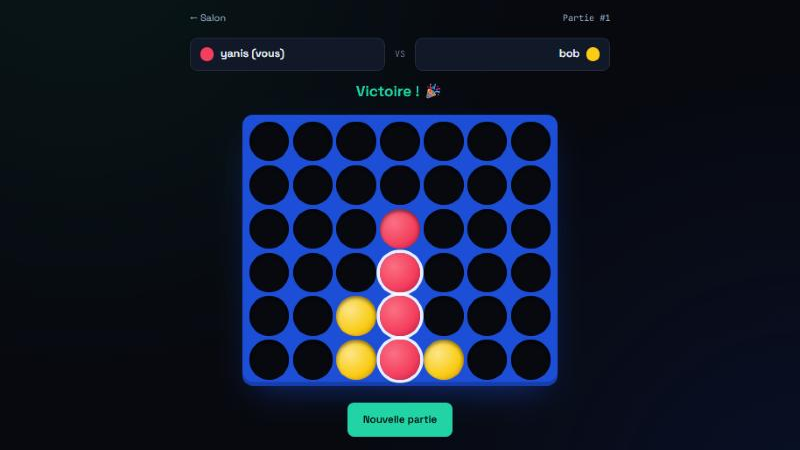

# Puissance 4 en ligne

Un Puissance 4 jouable à deux dans le navigateur, avec des comptes utilisateurs. Le projet est écrit en **Go**, sans framework.



## Fonctionnalités

- **Comptes utilisateurs** : inscription, connexion et déconnexion.
- **Salon** : on crée une partie, puis on envoie le lien à un ami ou on rejoint une partie ouverte.
- **Partie en ligne** : chaque joueur joue depuis son navigateur, et la grille se synchronise toute seule.
- **Statistiques** : chaque joueur voit ses victoires, défaites et matchs nuls, et un classement les compare.
- **Abandon** : on peut abandonner une partie en cours, ou annuler une partie qui attend encore un adversaire.
- **Confort de jeu** : les jetons tombent avec une animation, la ligne gagnante s'allume, et les touches 1 à 7 permettent de jouer au clavier.

## Sécurité

Le projet a été pensé avec une approche cybersécurité :

| Risque | Protection mise en place |
|---|---|
| Vol de la base de données | Mots de passe hachés avec **bcrypt**, jamais stockés en clair |
| Injection SQL | Toutes les requêtes sont **paramétrées** (`?`) |
| Vol de session (XSS) | Cookie de session **HttpOnly**, en-tête **Content-Security-Policy**, échappement automatique de `html/template` |
| CSRF | Cookie **SameSite=Lax** et vérification de l'en-tête `Origin` sur les requêtes POST |
| Brute-force | Blocage après **5 échecs de connexion en 5 minutes** par IP |
| Énumération des pseudos | Même message d'erreur et même temps de réponse, que le pseudo existe ou non |
| Clickjacking | En-tête `X-Frame-Options: DENY` |
| Triche | Les règles sont vérifiées **côté serveur** : tour, colonne valide, partie en cours |

## Lancer le projet

Prérequis : [Go 1.22+](https://go.dev/dl/).

```bash
go run .
```

Ouvrez ensuite <http://localhost:8080>. Pour tester à deux sur le même ordinateur, utilisez une fenêtre normale et une fenêtre de navigation privée, avec un compte différent dans chacune.

Variables d'environnement facultatives :

| Variable | Défaut | Rôle |
|---|---|---|
| `PORT` | `8080` | Port d'écoute |
| `DB_PATH` | `puissance4.db` | Fichier de la base SQLite |

Tests de la logique du jeu :

```bash
go test ./...
```

## Structure

```
.
├── main.go             # Démarrage du serveur, routes, rendu des pages
├── auth.go             # Hachage, sessions, middlewares de sécurité, anti brute-force
├── handlers_auth.go    # Inscription / connexion / déconnexion
├── handlers_game.go    # Salon, pages de partie et API JSON
├── store.go            # Base SQLite : schéma, utilisateurs, sessions
├── store_games.go      # Base SQLite : parties, coups, statistiques
├── game/               # Règles du Puissance 4 (indépendantes du web) + tests
├── templates/          # Pages HTML (html/template)
└── static/             # CSS et JavaScript du jeu
```

## Choix techniques

- **Go standard** (`net/http`, `html/template`, `embed`) : le binaire contient les pages et le CSS, il n'y a qu'un seul fichier à déployer.
- **SQLite** via `modernc.org/sqlite`, un pilote écrit en Go pur, donc sans compilateur C à installer.
- **Polling** toutes les secondes plutôt que des WebSockets : c'est plus simple et largement suffisant pour un jeu au tour par tour.
- Chaque coup est joué dans une **transaction** pour éviter que deux requêtes simultanées corrompent la partie.

## Organisation Git

- `main` : version stable
- `develop` : intégration des fonctionnalités
- `feature/*` : une branche par fonctionnalité (`game-logic`, `auth`, `multiplayer`), fusionnée dans `develop`

---

Projet réalisé par [Yanis Calonge](https://portfolio-ten-khaki-63.vercel.app), étudiant en Bachelor Cybersécurité à Ynov Toulouse.
